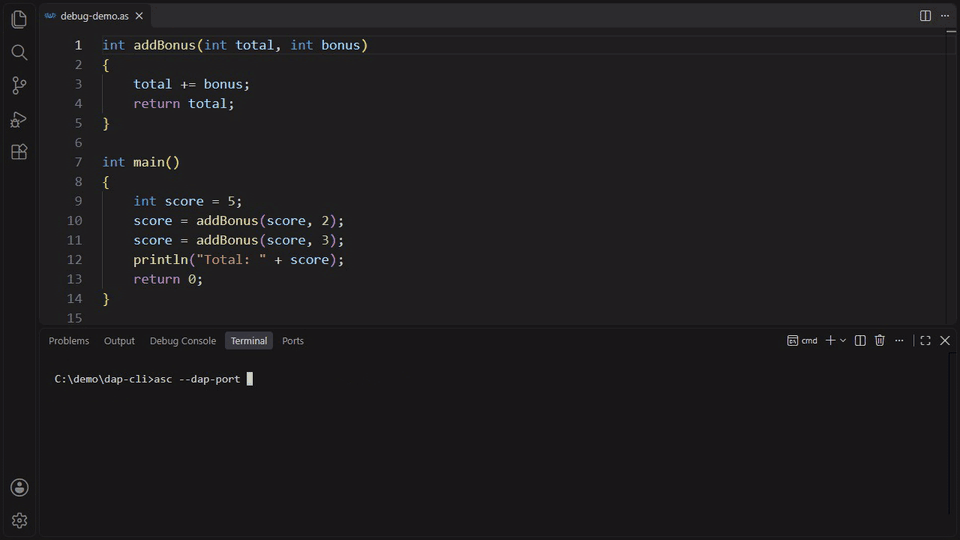

# AngelScript DAP

**[English](README.md)** | **[Español](docs/README.es.md)**

A host-agnostic Debug Adapter Protocol (DAP) server for AngelScript. Embed it in a C++ application, attach VS Code, and debug scripts with breakpoints, stepping, call stack and variables.

## What you get

- Source-level breakpoints, step over, step in, step out, continue and pause.
- Call stack, locals, parameters and globals, with objects, arrays, dictionaries and strings expanded.
- A TCP DAP server (port `9002` by default) that VS Code's `attach` and `launch` flows use.
- A small host interface (`asIDBHostAdapter`) and a ready adapter for the vanilla `string`, `array` and `dictionary` add-ons.
- Supports AngelScript **2.36.0 and later**. Older releases run scripts but have no context introspection for debugging; see the [engine matrix](https://github.com/Gaftherman/angelscript-cli/blob/main/docs/ENGINE_VERSIONS.md).

## Use it

Add AngelScript and this repository to your CMake project. A C++20 compiler, CMake 3.21+, Git and Python 3 (for the cppdap patch) are required.

~~~cmake
add_subdirectory("${ANGELSCRIPT_SDK}/angelscript/projects/cmake" angelscript)
set(ASDEBUGGER_STD_ADAPTER ON)
set(ASDEBUGGER_STD_ADDON_DIR "${ANGELSCRIPT_SDK}/add_on")
add_subdirectory(external/angelscript-dap)

add_executable(my_host main.cpp)
target_link_libraries(my_host PRIVATE angelscript_dap)
~~~

| Variable | Purpose |
| --- | --- |
| `ASDEBUGGER_STD_ADAPTER` | Build the adapter for the vanilla add-ons (`ASDEBUGGER_STD_ADDON_DIR` must point to `sdk/add_on`). Leave it off to implement `asIDBHostAdapter` yourself. |
| `ASDEBUGGER_ANGELSCRIPT_TARGET` | Name of your AngelScript target when it is not `angelscript`, or a headers-only target. |
| `ASDEBUGGER_CORE_COMPILE_OPTIONS` | Extra private compile options, for example `-m32` for a 32-bit host. |
| `ASDEBUGGER_BUILD_TESTS` | Build the core tests. |

The target is `angelscript_dap`; `asdebugger_core` is the same library under its earlier name.

The [example project](https://github.com/Gaftherman/angelscript-debugger-example) shows a complete host and a VS Code setup. The [AngelScript CLI](https://github.com/Gaftherman/angelscript-cli) is a ready-made host: `angelscript --dap-port 9002 script.as`.

## Develop

The core links against an AngelScript target that the parent project supplies, so it is built and tested through the [example project](https://github.com/Gaftherman/angelscript-debugger-example), which provides the engine (`ASDEBUGGER_BUILD_TESTS` is on there). See [CONTRIBUTING.md](CONTRIBUTING.md).

## Support

Open an [issue](https://github.com/Gaftherman/angelscript-dap/issues) for the debugger core. See [docs/SUPPORT.md](docs/SUPPORT.md) for what to include.

## Related projects

| Project | Use |
| --- | --- |
| [angelscript-debugger-example](https://github.com/Gaftherman/angelscript-debugger-example) | A host and scripts that show how to use the debugger |
| [angelscript-cli](https://github.com/Gaftherman/angelscript-cli) | Run, check and debug scripts from the terminal |
| [angelscript-lsp](https://github.com/Gaftherman/angelscript-lsp) | Editor support for VS Code |
| [asdebugger](https://github.com/Gaftherman/asdebugger) | The Sven Co-op plugin built on this core |

## License

[MIT](LICENSE). Third-party notices are in [docs/THIRD_PARTY.md](docs/THIRD_PARTY.md).
