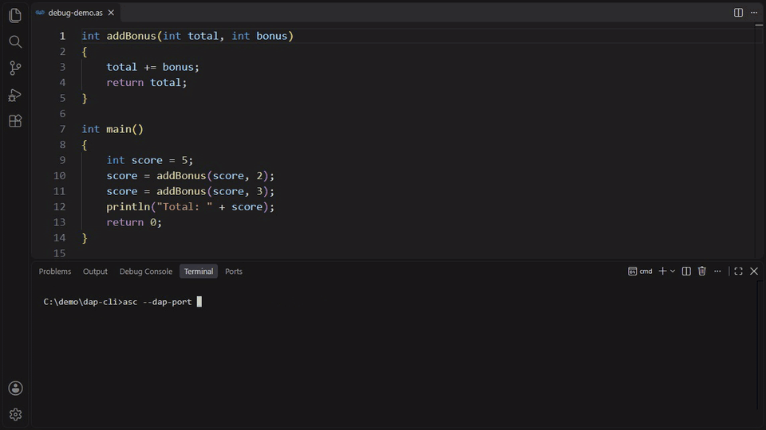

# AngelScript DAP

**[English](../README.md)** | **[Español](README.es.md)**

Un servidor del Debug Adapter Protocol (DAP) para AngelScript, independiente de la aplicación. Insértalo en una aplicación C++, conecta VS Code y depura scripts con puntos de interrupción, ejecución paso a paso, pila de llamadas y variables.

## Qué incluye

- Puntos de interrupción en el código fuente, paso por encima, paso al interior, paso al exterior, continuar y pausar.
- Pila de llamadas, variables locales, parámetros y globales, con objetos, arreglos, diccionarios y cadenas expandidos.
- Un servidor DAP por TCP (puerto `9002` por defecto) que usan los flujos `attach` y `launch` de VS Code.
- Una interfaz pequeña para la aplicación (`asIDBHostAdapter`) y un adaptador listo para los add-ons `string`, `array` y `dictionary` de AngelScript.
- Admite AngelScript **2.36.0 y posteriores**. Las versiones anteriores ejecutan scripts, pero no tienen la introspección del contexto necesaria para depurar; consulta la [matriz de versiones](https://github.com/Gaftherman/angelscript-cli/blob/main/docs/ENGINE_VERSIONS.md).

## Cómo usarlo

Añade AngelScript y este repositorio a tu proyecto de CMake. Se necesitan un compilador C++20, CMake 3.21+, Git y Python 3 (para el parche de cppdap).

~~~cmake
add_subdirectory("${ANGELSCRIPT_SDK}/angelscript/projects/cmake" angelscript)
set(ASDEBUGGER_STD_ADAPTER ON)
set(ASDEBUGGER_STD_ADDON_DIR "${ANGELSCRIPT_SDK}/add_on")
add_subdirectory(external/angelscript-dap)

add_executable(my_host main.cpp)
target_link_libraries(my_host PRIVATE angelscript_dap)
~~~

| Variable | Función |
| --- | --- |
| `ASDEBUGGER_STD_ADAPTER` | Compila el adaptador de los add-ons de AngelScript (`ASDEBUGGER_STD_ADDON_DIR` debe apuntar a `sdk/add_on`). Déjalo desactivado para implementar `asIDBHostAdapter` tú mismo. |
| `ASDEBUGGER_ANGELSCRIPT_TARGET` | Nombre de tu destino de AngelScript si no es `angelscript`, o un destino que solo aporta cabeceras. |
| `ASDEBUGGER_CORE_COMPILE_OPTIONS` | Opciones de compilación privadas adicionales, por ejemplo `-m32` para una aplicación de 32 bits. |
| `ASDEBUGGER_BUILD_TESTS` | Compila las pruebas del núcleo. |

El destino es `angelscript_dap`; `asdebugger_core` es la misma biblioteca con su nombre anterior.

El [proyecto de ejemplo](https://github.com/Gaftherman/angelscript-debugger-example) muestra una aplicación completa y la configuración de VS Code. La [CLI de AngelScript](https://github.com/Gaftherman/angelscript-cli) es una aplicación lista para usar: `angelscript --dap-port 9002 script.as`.

## Desarrollo

El núcleo enlaza con un destino de AngelScript que aporta el proyecto padre, así que se compila y prueba mediante el [proyecto de ejemplo](https://github.com/Gaftherman/angelscript-debugger-example), que aporta el motor (allí `ASDEBUGGER_BUILD_TESTS` está activado). Consulta [CONTRIBUTING.es.md](CONTRIBUTING.es.md).

## Soporte

Abre una [incidencia](https://github.com/Gaftherman/angelscript-dap/issues) para el núcleo del depurador. En [SUPPORT.es.md](SUPPORT.es.md) se indica qué incluir.

## Proyectos relacionados

| Proyecto | Uso |
| --- | --- |
| [angelscript-debugger-example](https://github.com/Gaftherman/angelscript-debugger-example) | Una aplicación y scripts que muestran cómo usar el depurador |
| [angelscript-cli](https://github.com/Gaftherman/angelscript-cli) | Ejecuta, comprueba y depura scripts desde la terminal |
| [angelscript-lsp](https://github.com/Gaftherman/angelscript-lsp) | Soporte del editor para VS Code |
| [asdebugger](https://github.com/Gaftherman/asdebugger) | El complemento de Sven Co-op construido sobre este núcleo |

## Licencia

[MIT](../LICENSE). Los avisos de terceros están en [THIRD_PARTY.md](THIRD_PARTY.md).
